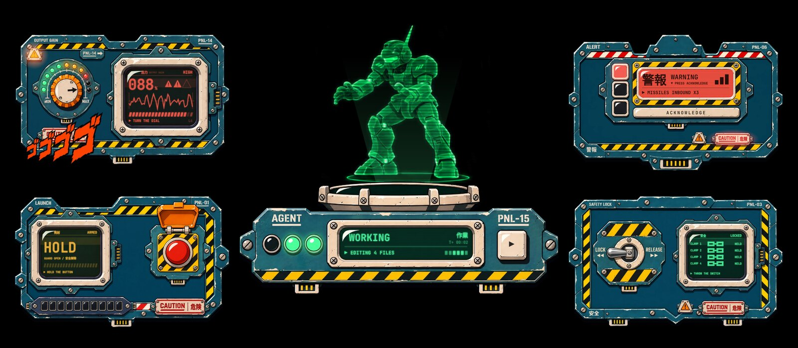

# Cockpit UI

Ordinary UI controls as the cockpit of a 1990s giant-robot anime. A slider is a dial beside a screen. A checkbox group is a pre-launch checklist. A confirm button is a red button under a safety guard that you hold until the robot launches. Each piece is a painting mounted on its own painted backing sheet, the screens are drawn live, and every control reacts like an anime when you use it: sound-effect lettering, two black-and-white impact frames, and a cut-in panel of the robot, the pilot or the crew.

Under the paintings are real controls, so they work with a keyboard, a screen reader and a form. Each one is a single file that defines a custom element, with its paintings inside it, so there is nothing else to fetch. No dependencies, no build step for you, MIT licensed.



## The eleven

| | element | what it does |
|---|---|---|
| [Launch](launch/) | `<cockpit-launch>` | Hold to confirm. Lift the orange guard, then hold the red button: lamps count up, the screen counts down, and at the end the robot launches across the control. |
| [Output gain](dial/) | `<cockpit-dial>` | A slider you turn. Lamps light round the dial and the screen climbs from green to red; at 100 the pilot cuts in. |
| [Pre-launch check](checklist/) | `<cockpit-checklist>` | Four checkboxes with a tally screen. Tick all four and the deck crew wave you off. |
| [Safety lock](lock/) | `<cockpit-lock>` | A switch. Throw it and four clamps let go one after another; the last one blows the restraints. |
| [Drive mode](mode/) | `<cockpit-mode>` | A radio group of four lit keys. Choosing combat brings the robot's fist. |
| [Alert](alert/) | `<cockpit-alert>` | A notification at three levels with an acknowledge bar. A warning flashes red and brings the missiles. |
| [Monitor select](tabs/) | `<cockpit-tabs>` | Three tabs over one screen, cutting through static. Wait on the rear camera and something turns up. |
| [Agent state](agent/) | `<cockpit-agent>` | A status display for an AI agent: the robot as a turning hologram whose pose and colour follow the state. |
| [System load](loading/) | `<cockpit-loading>` | A loading bar. Feed it progress; at 100 the robot's visor lights. |
| [Active time](stepper/) | `<cockpit-stepper>` | A stepper for minutes and seconds. At five minutes the power cable comes out. |
| [Callsign](input/) | `<cockpit-input>` | A text input. Press Enter and the bridge answers. |

## The look

Each control is one flat piece of 1990s mecha-anime cel art: bold black ink outlines, flat colour with one hard shadow and one hard highlight, worn navy-teal metal, bone-white bezels, hazard stripes and stencil text. The backing sheet, the dial, the buttons, the bezels and the lettering are paintings, cut out and mounted on the sheet. The readings on the glass, the lamps and the moving parts are drawn by the file, twelve drawings a second, the rate a 1990s TV anime moved at.

The reactions are the anime part. Each new level or state pops a piece of painted Japanese sound-effect lettering (カチッ for a click, ピピッ for a beep). The big moment in each control gets two impact frames, in which the whole control flashes white then black as a silhouette, then a large word (ドン!, 解除!, 発進!) and a cut-in: a slanted panel across the control showing the pilot's eyes, the thrusters, the clamps, a missile salvo, the bridge officer. Every control has its own.

The controls float with no card behind them. They are drawn for a black page.

## Try them

Live: https://cockpit-ui-kit.vercel.app

Or run it yourself:

```sh
python3 -m http.server 8000     # from this folder
# open http://localhost:8000/
```

That opens the gallery, with all eleven live.

## Use one

Each is a single file that defines an element. Install it with the shadcn CLI, which puts the file in `public/cockpit-ui/`:

```sh
npx shadcn add finktheartist/cockpit-ui/launch
npx shadcn add finktheartist/cockpit-ui/dial
npx shadcn add finktheartist/cockpit-ui/agent
# ...checklist, lock, mode, alert, tabs, loading, stepper, input
```

Or copy the file into your project by hand. Then load it with a plain script tag and use its element:

```html
<script src="launch.js"></script>
<cockpit-launch></cockpit-launch>          <!-- listen for cockpit:launch -->

<script src="dial.js"></script>
<cockpit-dial name="gain" value="20"></cockpit-dial>

<script src="agent.js"></script>
<cockpit-agent></cockpit-agent>             <!-- then el.set('working', 'editing 4 files') -->
```

Each folder's README lists the attributes, properties, methods and events. The value controls (dial, checklist, lock, mode, stepper, tabs, input) fire `input` and `change` and work inside a `<form>` with a `name`.

- **Size.** Each is a painting up to 640 pixels wide. In a narrower container it scales down, text and hit areas included. At phone width the text on the screens is small.
- **The line.** Every control says something about what just happened ("Limiter one released. It was mostly there for morale."). It is in `el.line`, and each new one fires a `cockpit:line` event with `{ text }`. The gallery shows it under each control; you can show it or ignore it. It is also read out to screen readers.
- **Attributes set the start.** Use the properties and methods after that. Values set from code go straight there, without the lettering or the cut-in.
- **How the files share.** Each file carries its own paintings and a copy of the core (the clock, the custom-element base, the lettering, the impact frames and the cut-in, about 12 KB). The first one loaded sets `window.Cockpit` and the others reuse it, so any mix of them on a page shares one clock.
- **The files are large,** because the paintings are inside them: 440 KB to 1.1 MB each, and 2.8 MB for the agent display, which carries four short video clips. Load only the controls a page uses.

For agents, [llms.txt](llms.txt) lists every file and what it is. In the gallery each control has its install line and a "Copy a prompt" button; the prompt points a coding agent at the real file and tells it to wire it in, not redraw it.

## Make your own

`skills/cockpit-ui/` is the workflow these were made by, written as a skill for a coding agent. Install it with:

```sh
npx skills add finktheartist/cockpit-ui
```

Or copy the folder into your agent's skills folder by hand (for Claude Code, `~/.claude/skills/`). It has:

- `SKILL.md`, the workflow and the rules, most of them corrections from building this set.
- `core.js`, the core every control is built on.
- `starter.html` and `art/`, the smallest whole example: a mute switch with its own screen.
- `look.mjs`, which photographs a page at chosen moments after an action and saves the frames side by side, so a reaction can be checked drawing by drawing.

An agent with the skill gets a reasonable first pass. These took many rounds of looking at stills and repainting, and yours will too.

[making-of/](making-of/) is how the paintings were made: the directions that were dropped, every image and video prompt, how a painting on magenta becomes a mounted piece, and how the hologram was made to turn.

## Working on this repo

- `core.js` is the source of the shared core. After editing it, run `node tools/build.mjs`, which stamps it and each control's paintings from `art/NAME/` into every control file (between the `// >>> cockpit core` and `// >>> art` markers) and into the skill. `node tools/build.mjs --check` exits 1 if any file is out of date.
- `art/NAME/` holds the paintings each control carries, at the size they are shipped. Everything in the folder goes into the file.
- `tools/spec.mjs` says what each control is. `node tools/docs.mjs` writes every folder's `README.md` and `index.html`, the gallery, `registry.json` and `llms.txt` from it, so edit the spec and not those files. Run it after `build.mjs`, since it quotes the file sizes.
- `node tools/test.mjs http://localhost:8000/gallery/` uses every control with real touch and key events at phone width, checks the events, the form values and sideways scroll, and exits 1 on a failure. `node tools/shot.mjs URL OUT W H SCALE` takes a screenshot. Both need Chrome or Chromium (`CHROME=...` if it is somewhere unusual).

## Limits

- **Checked in headless Chromium,** with real touch and key events and stills of every reaction. Not yet tried in Safari or Firefox, on a real phone, or with a screen reader.
- **Drawn for a dark page.** On a light background the black outlines and the glowing screens look wrong.
- **The labels are painted.** The stencil text, the key caps' words and the Japanese lettering are part of the art and cannot be changed or translated. The four checklist rows, the four drive modes and the three tabs are fixed.
- **The cut-ins cover the control** for about a second and a half, and the launch picture spills outside it.
- **No sound.**
- **Reduced motion** skips the shaking, the impact frames and the cut-ins, holds the lettering still and stops the hologram turning.

## License

MIT. See [LICENSE](LICENSE). The robot, the pilot, the crew, the hostile machine and the lettering are original designs; no existing anime's or game's characters or mecha are used. The paintings and the hologram clips were generated with GPT Image and Seedance (through Higgsfield) for this project.
