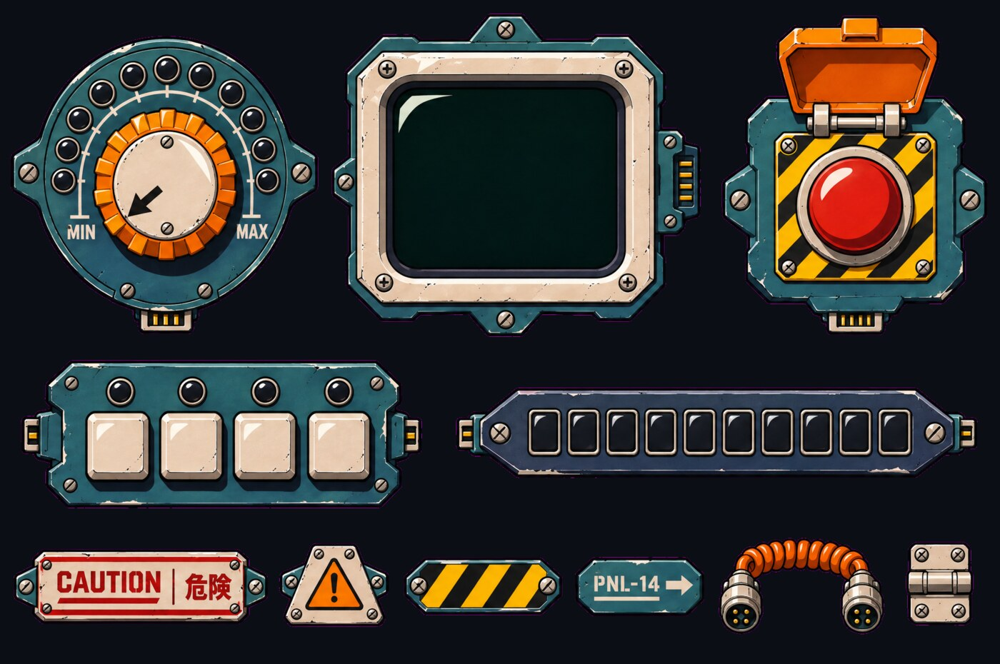
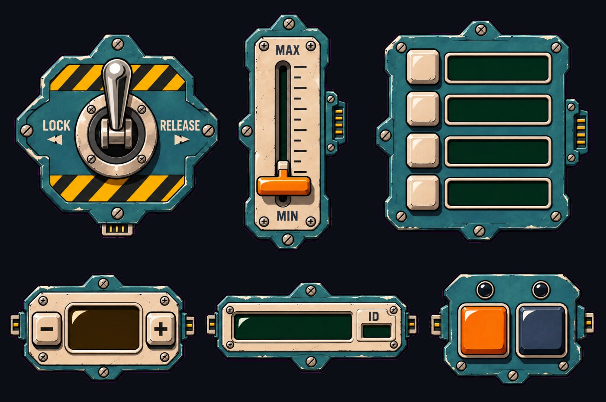
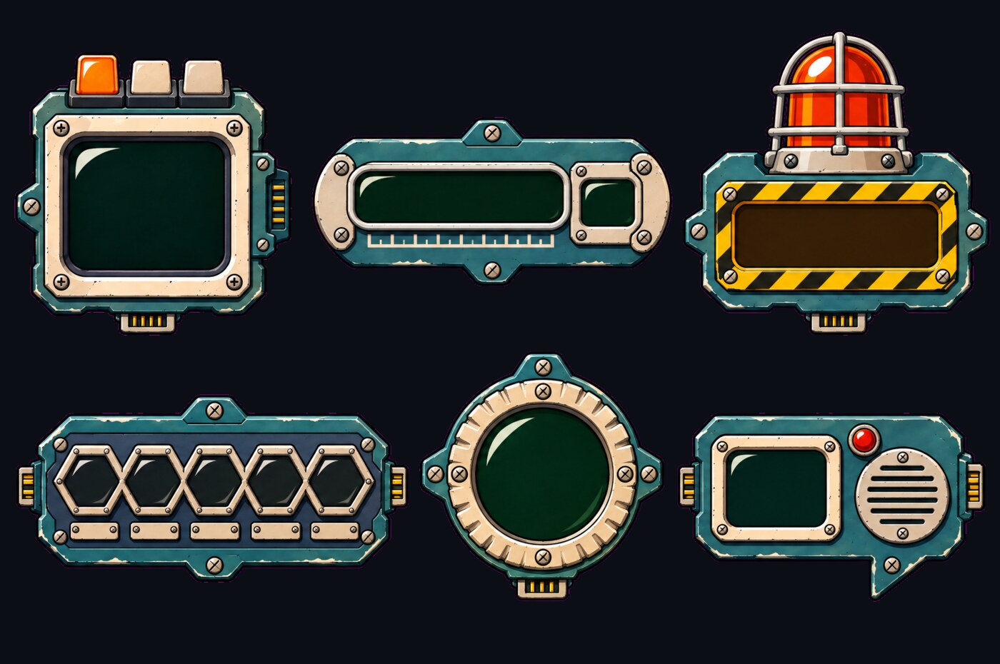
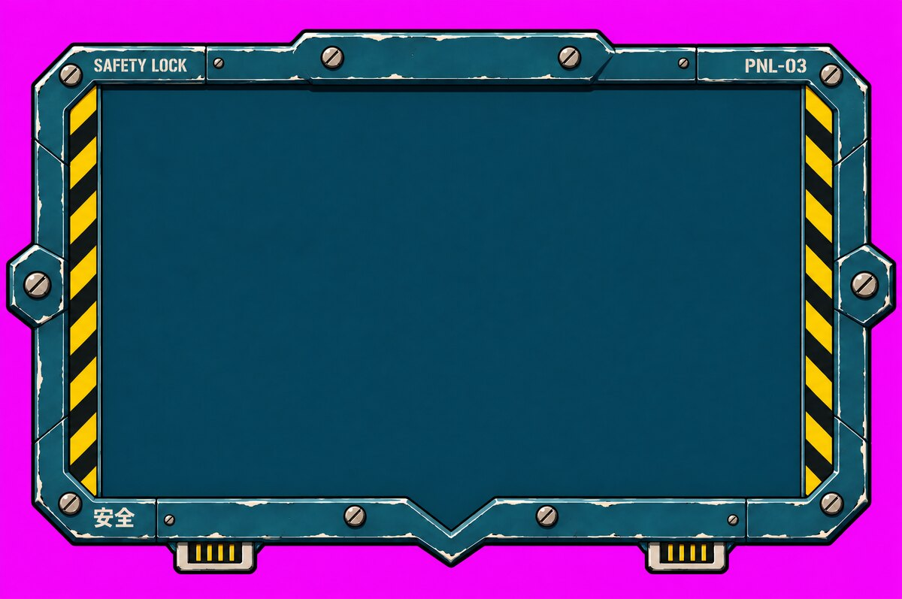
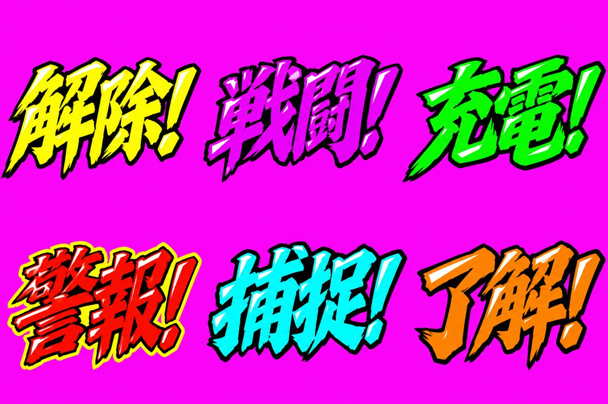
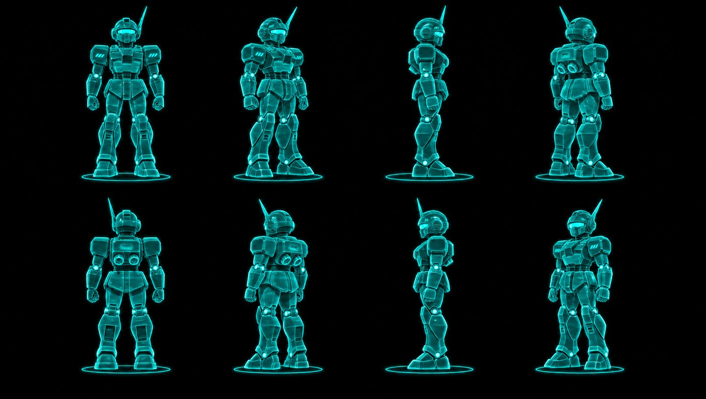

# How the art was made

Every piece in Cockpit UI is a painting: the backing sheets, the dial, the buttons, the bezels, the lettering, the cut-ins and the hologram. The code draws only what changes: the readings on the glass, the lamps, the moving parts. This is how a control goes from an idea to a mounted piece that reacts. Every prompt is in [prompts.md](prompts.md), in order.

## 1. What was dropped

The first concept sheets painted whole cockpit consoles, with the pilot's gloved hands on the controls. They looked like anime stills but not like controls you could put on a page: too big, and the hands made each one a scene. They were dropped.

The second try drew the controls in code, as illustrated strips. That was not anime art either, and was dropped the same day.

What worked: **one control per plate, painted flat and straight on, with only the readings drawn in code.** The first was a dial beside a screen whose readings climb as you turn it. Everything after followed that recipe.

## 2. Parts sheets

Rather than paint each control whole, the parts were painted together on sheets, like a model kit: dial pods, screens, button blocks, key rows, lamp strips, caution plates and hazard decals. Painting them on one sheet keeps one line weight and one palette across all of them.

Two more sheets followed for inputs (toggle, stepper, text field, command keys) and displays (tabbed monitor, beacon, round scope, speaker screen), each with the first as its style reference.

## 3. Painted on magenta, then cut out

Every piece was asked for on a flat, uniform magenta background (#FF00FF), which no part of the palette uses. Cutting is then mechanical: make the magenta transparent with a little tolerance, erode the edge by a pixel and a half to take off the pink fringe, and find each piece by its connected shape so nothing depends on where the model put it. Lettering in purple or pink is the exception; it was cut by flood-filling the background from the edge instead.

## 4. One sheet per control

Each control has its own backing sheet: the same metal, stripes and screws, a different outline, and stencil text naming it in the corners (OUTPUT GAIN, PNL-14, 出力). The sheets were asked for **empty in the middle**, so the cut-out pieces could be mounted on them. Each new sheet used the first one as its reference.

A piece is mounted by measuring it: the window inside a screen bezel, the lamp sockets round a dial, the key caps in a row are found by thresholding the dark glass and reading off their boxes as fractions of the piece. Those numbers become the canvas positions and lamp positions in each file.

## 5. Reactions

The reactions are what make it anime:

- **Lettering,** one sheet of Japanese sound effects per batch, each in its own colour: カチッ (click), ピピッ (beep), ゴゴゴゴ (rumble), ドン! (boom), and a big title word per control's climax.
- **Impact frames,** done in code: two drawings in which every layer is pushed to black and white, then inverted.
- **Cut-ins,** one per control, each a wide letterboxed insert shot: the pilot's eyes, the thrusters, the deck crew, the clamps blowing open, the robot's fist, the power cable, a missile salvo, a hostile machine, the bridge officer, a thumbs-up. The rule was that no two controls reuse one.

The set floats on black with no card behind it. A cut-in used to be a strip cut off at the card's edge; on black that looked chopped, so it became a slanted panel with hard ends that wipes in from the right and out to the left.

## 6. Making the hologram turn

The agent display's robot is a hologram that turns. It was painted three ways before it worked:

1. **Four poses,** cyan line art on black, one per state. They read as flat cut-outs.
2. **Eight angles per pose,** as a turnaround sheet, shown one after another. It turned, but in visible 45-degree steps.

3. **A four-second turntable clip per pose,** generated from the front view as both the first and the last frame, with the turnaround sheet as a reference so the back matched. One full turn at a constant speed, starting and ending on the same view, so it loops. These are what ship, cropped and re-encoded small, inside the file.

The hologram is the one part of the set that moves smoothly rather than twelve drawings a second; as a projection, it reads as something else in the cockpit.

## 7. Making it explain itself

Late on, a test showed the controls did not say what they were. Three things were added: a caption over each (in the gallery and the demo pages), a prompt on each control's own screen until it is first used (TURN THE DIAL, THROW THE SWITCH), and plain words where the art had abbreviations (ACKNOWLEDGE, not ACK; CRUISE, not CRS).
